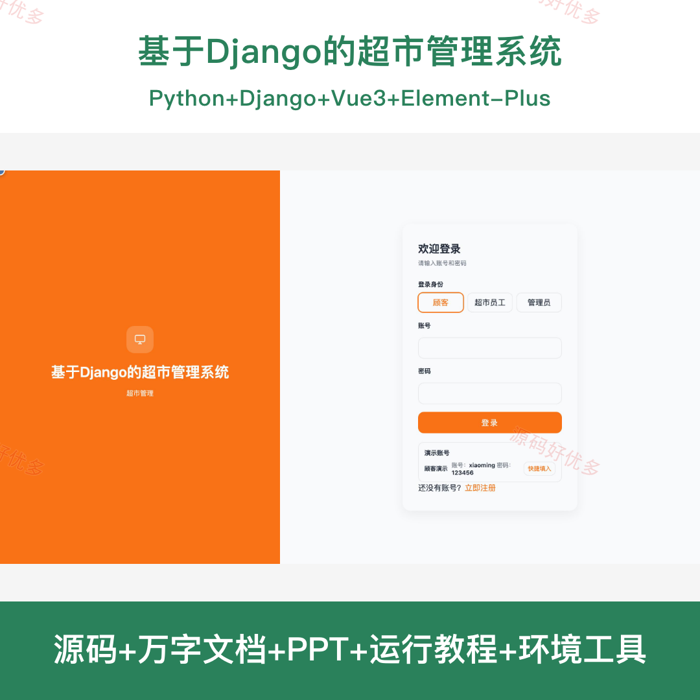
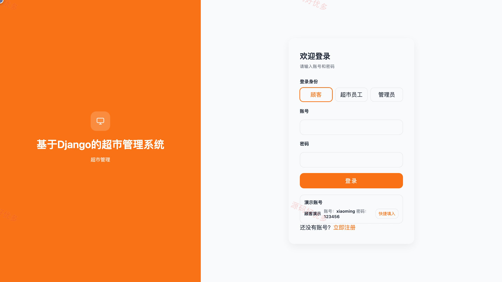
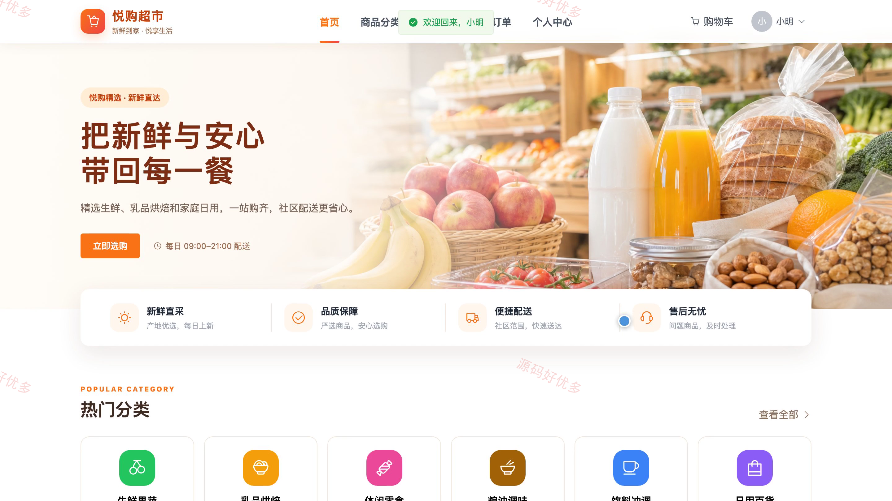
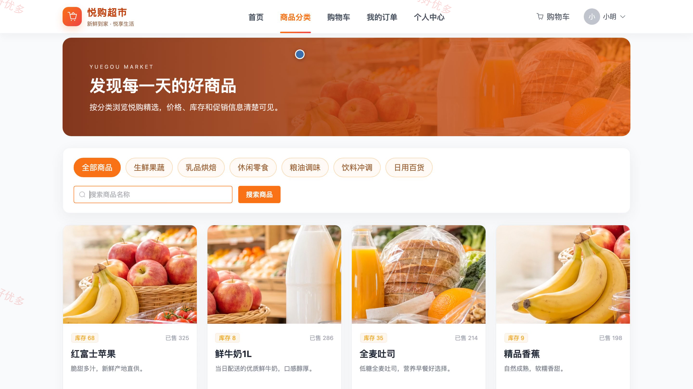
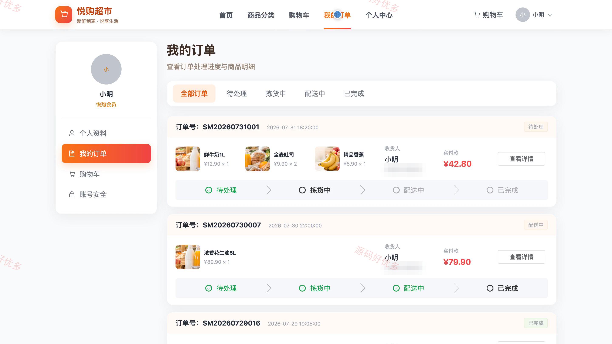
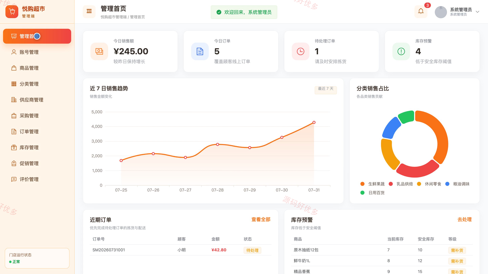
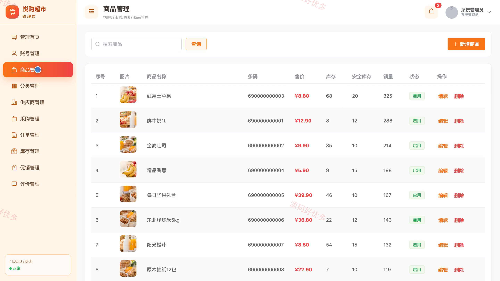
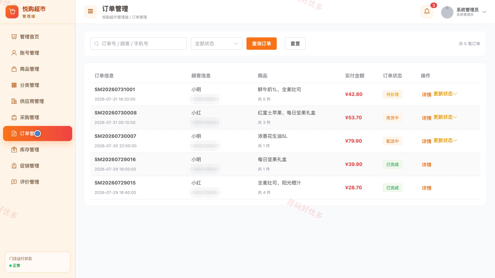
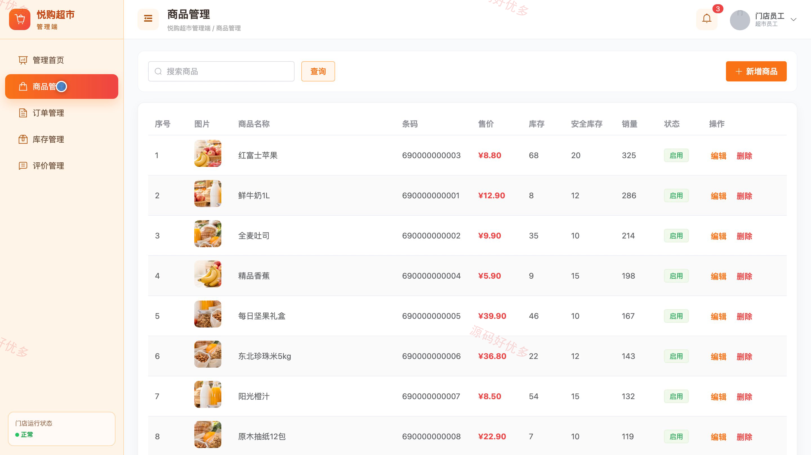

# bs015B
bs015B基于Django的超市管理系统源码 Python Django Vue3 前后分离
## 源码问题查看主页咨询

### 一、关键词
超市运营、商品库存、采购入库、在线购物、订单管理

### 二、作品包含
源码+数据库+万字设计文档+PPT+全套环境和工具资源+本地部署教程

### 三、项目技术
前端技术： Html、Css、Js、Vue3.4、Element-Plus
后端技术：Python、Django

### 四、运行环境要求
开发工具：PyCharm + VSCODE

数据库：MySQL5.7（共14张表）

数据库管理工具：Navicat10以上版本

环境配置软件： Python3+

前端Nodejs：16+

浏览器：谷歌浏览器

### 五、项目介绍
项目编号：bs015B

基于Django的超市管理系统面向顾客、超市员工、管理员，提供项目核心业务等功能，实现各角色在系统中的实际业务协作。

角色：顾客、超市员工、管理员

顾客功能：商品浏览与搜索、购物车管理、订单提交与模拟支付、订单状态跟踪、商品评价、个人资料与收货地址维护、登录注册、密码修改。

超市员工功能：工作台数据概览、商品资料查询、订单处理、库存盘点、商品入库、商品出库、库存预警、评价处理。

管理员功能：销售与库存统计、账号管理、商品与分类管理、供应商管理、采购管理、订单监管、库存监管、促销与评价管理。

### 六、运行截图

